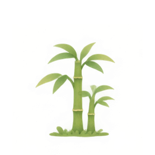

# Bamboo 手机应用工作仓库

这是独立于 Aksharam 的本地 Git repo。手机 UI 入口是 `index.html`，运行 `npm run dev` 后访问 http://127.0.0.1:5187/ 。无需安装前端依赖。

代码、素材、研究、分工与工作记录一起保存在本仓库。队友先看 `BACKEND-HANDOFF.md`。Public GitHub repo：https://github.com/xibahbah/bamboo-mobile 。目前此仓库已公开，供三人协作。

当前实现是可交互的手机优先网页 UI：1.8 秒投币竹节形变开场、左上侧栏、组织与个人混合信息流、个人 Stories / Recipes / Culture、点赞收藏、资料编辑、模拟资金与成长、主动选择上墙。后端、真实支付、原生 app 外壳与 Widget 接入尚未实现。

## 成长素材包

打开 `preview.html` 可拖动第 1–90 天，预览成长、轻微摇摆、竹筒回应与 Widget 外观。文件使用相对路径，完整保留 assets 文件夹即可离线查看。

## 素材

- `assets/days/day-01.png` 至 `day-30.png`：30 张 320×320 透明 PNG，统一基线。
- `assets/bamboo-growth.gif`：175 帧，日状态之间使用交叉淡化；奶油背景，循环时回到第 1 天。
- `assets/growth-frames/`：175 张透明过渡帧。
- `assets/bamboo-grove-idle.gif` 和 `idle-frames/`：36 帧轻微摇摆。
- `assets/bamboo-bank.png`：竹筒本体；`bamboo-bank-thanks.gif` 与 `bank-frames/`：36 张回应动画 PNG（GIF 会合并重复帧）。
- `assets/groves-2.png`、`groves-3.png`：60/90 天多片竹林示意。
- `assets/growth-contact-sheet.jpg`：30 天总览。
- `assets/widget/`：第 1、7、15、30 天透明静态素材；不包含原生 Widget 工程。
- `assets/bamboo-motion.css`：网页轻微摇摆、呼吸、单次成功反馈；支持 prefers-reduced-motion。
- `assets/manifest.json`：素材路径与帧数。

图片源图使用内置 imagegen 生成；Python/Pillow 仅进行裁切、对齐、缩放、帧合成与 GIF 打包。成长图是插画序列加淡化，不是骨骼动画。单日原始裁片约 229px，输出 320px 适合小组件；不要用作全屏高清背景。

## 前端最快接法

```html
<link rel="stylesheet" href="/assets/bamboo-motion.css">


```

以服务器返回的 growth 字段选 PNG。支付成功后给竹筒加 `is-success`，animationend 后移除；动效本身不修改账户。GIF 主要用于展示与视频；正式页面推荐 PNG + CSS。减少动态效果时展示静态 PNG，不自动播放 GIF。

第 30 天是一片竹林。超过 30 天用竹林数量加下一片进度；示例预览 31–59 天仍显示已获得的第一片，60 天显示两片，90 天显示三片，避免突然缩回小竹笋。

## 文件分工

`TEAM-2H.md` 给团队；`API-CONTRACT.md` 给后端；`RESEARCH.md` 是官网参考与设计取舍。此包没有实现后端、真实收款、消息投递或原生 iOS Widget。

## 生成提示词摘要

成长原图：单张 6 列 × 5 行、30 格透明 sprite atlas；竹笋逐日长成竹林；统一位置和基线；鼠尾草绿、暖黄、温柔手绘质感；无文字、无边框、无人物、无盆栽。

竹筒原图：透明背景的圆润竹制储蓄筒；三节竹身、浅黄顶部投币口、一片小叶；与成长图一致的柔和纸感；无文字、无人脸、无场景背景。使用内置 imagegen，未使用 CLI/API fallback。

重新导出：`python3 scripts/build_assets.py`，然后 `python3 scripts/build_bank.py`。依赖 Pillow。

## 简洁 UI 与测试

默认极简 Bamboo green 背景，You → Settings 可换 Morning mist / Soft clay。开场动效已启用；其余 hover 和环境动效保持关闭。`npm ci` 后执行 `npm test` 跑 40 项 UX 回归测试；测试覆盖本地演示，不代表后端已完成。

## 本轮可交互模拟

- 主页面：[在线 App](https://xibahbah.github.io/bamboo-mobile/)（1.8 秒形变 → Karma 弹出卡片 → 主页）。
- [直接进入主页](https://xibahbah.github.io/bamboo-mobile/?view=home)。
- [Morph 动画预览，可重播和拖动进度](https://xibahbah.github.io/bamboo-mobile/morph-preview.html)。
- 最新 UX 与后端权限边界：`docs/UX-MOCKUP.md` / `BACKEND-HANDOFF.md`。
- 首尾帧为新绘制的 SVG：`assets/intro/first-frame.svg`、`last-frame.svg`。运行 `python3 scripts/build_intro_frames.py` 可重新生成。
- 开场现在自动播放 1.8 秒，画面相对首尾帧初稿放大 25%。投币、竹节收小、轮廓变形、竹林生长连续完成。支持 Skip / Escape、减少动态效果和 Settings 重播。
- `python3 scripts/build_intro_motion.py` 生成 `intro-motion.js`：109 个矢量帧，运行时无几何依赖；作者工具需要 numpy、scipy、Pillow、contourpy。先运行 build_intro_frames.py，再运行 build_intro_motion.py。
- `morph-preview.html` 可重播或拖动 0–1800ms 进度；`?frame=first` / `?frame=last` 保留静态端点。当前 30 天插画/GIF 素材保持独立。

[直接预览 Karma](https://xibahbah.github.io/bamboo-mobile/?view=karma)。竹口已改为内嵌收拢，完整体验自动接上约半秒的 Karma 入场动效。
